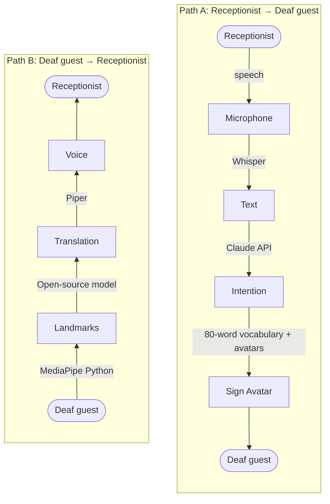

# Two-Way Sign Language Translator: Hotel Receptionist ↔ Deaf Guest

An iPad on the hotel reception desk translates live between a hearing receptionist (spoken English) and a Deaf guest (American Sign Language, ASL).

## 1. Workflow overview



```
PATH A: RECEPTIONIST ─speech─► Microphone ─Whisper─► Text ─Claude API─► Intention ─80 words + avatars─► Sign Avatar ─► DEAF
PATH B: DEAF ─MediaPipe (Python)─► Landmarks ─open-source model─► Translation ─Piper─► Voice ─► RECEPTIONIST
```

---

## 2. Path A: Receptionist speaks → Deaf guest sees signing

| # | Block | What it does | Tool |
|---|-------|--------------|------|
| A1 | Microphone | Records the receptionist's voice | iPad microphone |
| A2 | Text | Transcribes spoken English | **Whisper** |
| A3 | Intention | Maps the transcript to one of the **80 predefined hotel phrases** (check-in, ID please, room number, breakfast time, Wi-Fi, checkout…) and pulls out details like numbers and times | **Claude API** |
| A4 | Sign Avatar | Plays the premade avatar clip for that phrase (one clip per phrase). Names and numbers are fingerspelled. Captions are always shown too | **sign.mt** (avatar clip generation) |

**Vocabulary:** starts at **80 phrases** and can be expanded later. The same list is used in Path B.

**Cost note:** the Claude API is pay-per-use, though it costs very little at this scale. Every other tool here is free and open source.

---

## 3. Path B: Deaf guest signs → Receptionist hears speech

| # | Block | What it does | Tool |
|---|-------|--------------|------|
| B1 | Landmarks | Captures the guest on the iPad camera and extracts hand, face and body points per frame | **MediaPipe Holistic (Python)** |
| B2 | Translation | Recognizes signs from the landmarks (same **80-sign vocabulary** as Path A) and turns them into a natural English sentence | **Open-source sign classifier** (LSTM or Transformer, based on the Kaggle ASL competition models, trained on ASL Citizen / WLASL subsets + own recordings) |
| B3 | Voice | Speaks the sentence to the receptionist. The text is also shown on screen | **Piper** (open-source text-to-speech) |

---

## 4. App shell

| Layer | Tool | Role |
|-------|------|------|
| Front end | **Web app (Safari on iPad)** | Mic and camera capture, avatar and caption display, audio playback |
| Back end | **Python (FastAPI)** | Runs Whisper, the Claude API calls, MediaPipe, the sign classifier and Piper |
