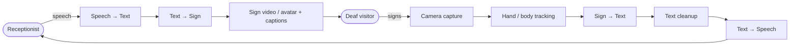

# Two-Way Sign Language Translator: Receptionist ↔ Deaf Visitor

An iPad on the reception desk translates live between a hearing receptionist (spoken English) and a Deaf visitor (American Sign Language, ASL).

## 1. Workflow overview



```
RECEPTIONIST ──speech──► [iPad] ──► text ──► sign video ──► DEAF
RECEPTIONIST ◄──speech── [iPad] ◄── text ◄── sign video ◄── DEAF
```

---

## 2. Path A: Receptionist speaks → Deaf visitor sees signing

| # | Step | What it does | Free options | Paid / closed options |
|---|------|--------------|--------------|-----------------------|
| A1 | Audio capture | Records the receptionist's voice | iPad microphone (AVAudioEngine or Web Audio API) | n/a |
| A2 | Speech → Text | Transcribes spoken English | **Apple Speech framework** (on-device) · **Whisper** (open source; *WhisperKit* for iPad, *whisper.cpp*) · **Web Speech API** (browser) | Google Cloud Speech-to-Text, Deepgram, AssemblyAI |
| A3 | Text → Sign | Converts English into sign-language poses | **sign.mt** (open source text-to-sign translation and pose generation) · English → ASL gloss with a local LLM (Gemma, Llama) | Signapse, Hand Talk (app only, no API), Sign-Speak |
| A4 | Display | Shows the avatar or signer, **plus captions** | **sign.mt renderer** · captions in the app UI | Signapse photorealistic signers |

**Note:** Always show captions next to the avatar. Many Deaf users prefer text for quick exchanges, and captions are accurate even when the avatar isn't.

---

## 3. Path B: Deaf visitor signs → Receptionist hears speech

| # | Step | What it does | Free options | Paid / closed options |
|---|------|--------------|--------------|-----------------------|
| B1 | Video capture | iPad front camera films the signer | iPad camera (AVFoundation or getUserMedia) | n/a |
| B2 | Hand / body tracking | Extracts hand, face and body points | **Google MediaPipe Holistic / Hands** (open source, web + iOS) · **Apple Vision** (hand-pose detection) | n/a |
| B3 | Sign → Text | Recognizes signs from the tracked points | Open models from Google's **Kaggle ASL competitions** (isolated signs, fingerspelling) · custom model trained on **ASL Citizen**, **WLASL**, **YouTube-ASL**, **How2Sign** | **Sorenson OmniBridge** (SDK) · **Sign-Speak** (API) · Google **SL2T** (Gboard on Pixel 11 only, no API) · **SignGemma** (announced, not released) |
| B4 | Text cleanup | Turns sign gloss ("YOU NAME WHAT") into natural English ("What's your name?") | Local LLM: **Gemma**, **Llama**, **Mistral** via **Ollama** | Gemini, Claude or GPT APIs |
| B5 | Text → Speech | Speaks the sentence to the receptionist | **Apple AVSpeechSynthesizer** (on-device) · **Piper** (open source) · **Coqui XTTS** (open source, voice cloning) · **ElevenLabs** free tier (limited credits, non-commercial) | ElevenLabs paid tiers (custom or cloned voice) |
| B6 | Display | Shows the recognized text on screen too | App UI | n/a |

**Differentiator:** The Deaf visitor can pick or design a **personal voice** (for example with ElevenLabs Voice Design) instead of a generic robot voice.

---

## 4. App shell

| Option | Cost | Pros | Cons |
|--------|------|------|------|
| **Web app (Safari on iPad)** | Free | Fastest to prototype. MediaPipe JS, Web Speech API and sign.mt all run in the browser | Slightly lower performance |
| **Native iPad app (SwiftUI)** | Free to build and run on your own device (Xcode) | Best performance, on-device Apple frameworks | App Store publishing costs $99/year |
